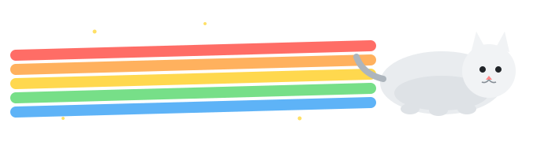

<!-- 🐱 自包含 SVG 横幅（纯 SVG，不依赖外部图床） -->

  

<h3>你好，我是 Jiang 👋</h3>

Computer Science undergrad · building LLM agent harnesses, RAG pipelines and deep learning from scratch

---

## 🐾 关于我

- 🎓 计算机科学在读，关注 **大模型应用 / Agent 编排 / 深度学习** 方向
- 🔭 当前在做：一个模型无关的 **agent harness** —— ReAct 循环、工具注册、可插拔 provider、流式回复、子智能体路由、本地向量与 TF-IDF 检索、会话轨迹与策略守卫
- 🧰 常用栈：`Python` `C++` `NumPy / PyTorch` `LangChain` `Git` `Linux`
- 🌱 在学：多智能体路由、检索增强生成（RAG）、本地模型部署与量化
- 📌 另外在玩：AI 辅助视频叙事、校园效率工具、AIGC 内容生产

## 🚀 精选项目

### [agent-harness-kit](https://github.com/jiang-2007/agent-harness-kit)
A model-agnostic **LLM agent harness**: ReAct loop, tool registry, pluggable providers, streaming replies, parallel sub-agent routing and aggregation, local vector and TF-IDF retrieval, structured trace, session persistence and policy guards. Standard-library core, offline mock provider, unit-tested.

`agent-framework` `llm` `agent-orchestration` `tool-calling` `multi-agent` `rag` `orchestration` `python`

### [focus-guardian](https://github.com/jiang-2007/focus-guardian)
纯本地的 Windows 生产力工具：记录电脑使用习惯，主动拦截干扰，保护专注时间。

## 🧰 技术栈

## 📊 GitHub 数据

 

---

### 🌟 欢迎路过，欢迎交流 🌟

Powered by Nyan Cat · <a href="https://github.com/jiang-2007/agent-harness-kit">agent-harness-kit</a>

